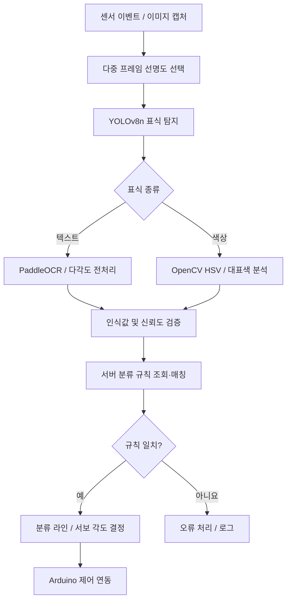
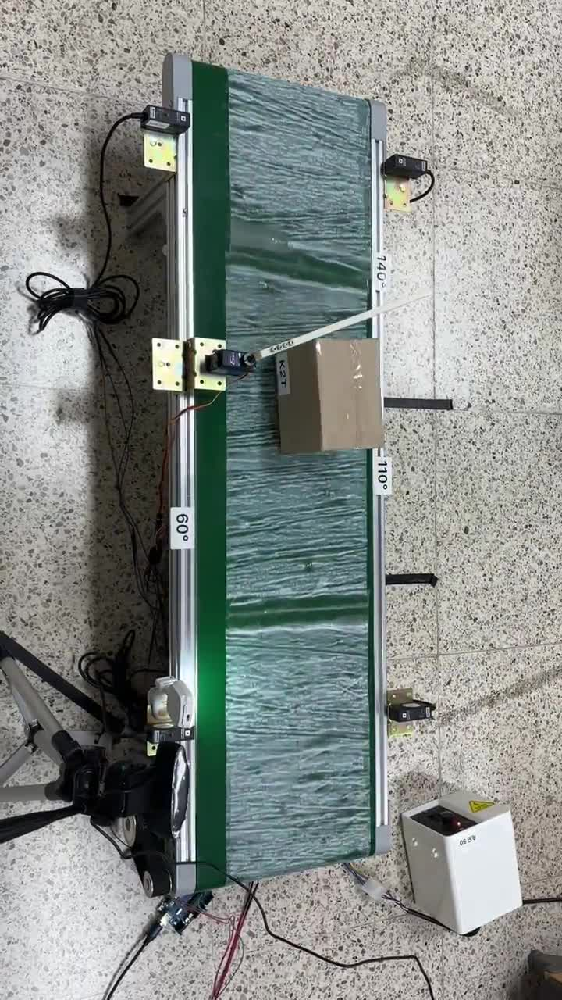

# 🧠 SmartParcel AI — 표식 인식 및 자동 분류 비전 파이프라인

> **SmartParcel AI Vision Module** · 
> YOLOv8n 객체 탐지 + PaddleOCR 텍스트 인식 + OpenCV HSV 색상 분석을 통해 물품 표식을 인식하고, 동적 분류 기준에 연결하는 AI 모듈

[통합 프로젝트](https://github.com/yoniyon03/smart-sort) · [웹 대시보드](https://github.com/yoniyon03/smart-sort-web) · [Arduino](https://github.com/yoniyon03/smart-sort-arduino)

---

## 🎯 Purpose

초기 택배 우편번호 OCR 중심의 제안을 확장해, **텍스트(`marker_text`)와 색상(`marker_color`) 표식을 모두 인식**하고 현장 설정에 따라 분류할 수 있도록 구성한 비전 파이프라인입니다. 실제 물리적 분류와 연결되므로 단일 이미지 분류 정확도뿐 아니라 **인식 실패·규칙 미일치·모션 블러**에 대한 대응도 중요하게 다루었습니다.

---

## 🛠 Tech Stack

    

**개발 환경(최종보고서):** Python · PyCharm · macOS/Apple M2 · Git/GitHub · Roboflow(데이터 라벨링).

---

## 🔍 Recognition Pipeline

### 핵심 설계

1. **데이터 수집·전이학습:** `objects`, `marker_text`, `marker_color` 클래스를 대상으로 커스텀 이미지와 Roboflow 라벨링을 사용했습니다.
2. **촬영 안정화:** 움직이는 컨베이어 환경에서 복수 프레임 중 선명한 프레임을 선택해 모션 블러를 완화했습니다.
3. **OCR:** 신뢰도가 충분하면 빠른 경로(`fast-pass`)를 사용하고, 그렇지 않으면 회전·전처리를 강화한 `multi-angle` 경로를 활용했습니다.
4. **색상:** HSV 색공간과 Hue 원형 특성, K-Means 기반 대표색 추출로 조명 변화에 대응했습니다.
5. **규칙 적용:** 유효한 텍스트 인식을 우선 적용하고, 미검출 시 색상 인식으로 처리하며, 규칙 부재나 낮은 신뢰도는 오류로 구분했습니다.

---

## 📊 Evaluation

| 지표 | 최종보고서 결과 | 비고 |
| --- | ---: | --- |
| YOLO mAP@0.5 | 약 **0.95** | 검증 데이터셋 |
| YOLO mAP@0.5:0.95 | 약 **0.75** | 검증 데이터셋 |
| YOLO Precision / Recall | 약 **0.90 / 0.95** | 모델 검증 |
| `marker_text` 혼동행렬 분류 | **80/82** | 클래스별 평가 |
| `marker_color` 혼동행렬 분류 | **46/49** | 클래스별 평가 |
| OCR Exact-match | **100% (100/100)** | K1S/K2T 라벨 샘플에 한정 |
| End-to-End 전체 분류 | **95.7% (287/300)** | AI·서버·Arduino·기구를 포함한 전체 시스템 |

> OCR 100%는 모든 환경에서의 성능이 아니라 **제시된 100장 시험셋의 결과**입니다. 최종 발표자료에는 별도 시험의 `marker_text` 탐지 86.4% / `marker_color` 100% 등이 기재되어 있으며, 서로 다른 시험 조건의 값을 하나로 합산하지 않았습니다.

---

## 🔗 Hardware & Server Integration

- 센서 감지와 카메라 캡처 시점을 동기화
- 서버에서 활성 그룹 및 규칙(`ruleId`, `chuteId`, `servoDeg`) 조회
- 텍스트/색상 인식 결과를 분류 라인 결정에 연결
- 시리얼 통신을 통해 Arduino 측 분기 동작 실행
- 분류·오류 결과를 서버로 전송하여 운영 이력 관리

> 아래 흐름은 시스템 수준의 연동 방식이며, 실제 HTTP 요청·시리얼 패킷의 상세 스키마는 소스코드를 기준으로 관리합니다.

---

## 👤 Team Ownership

**김나영 — AI Vision 담당**: 이미지 촬영·라벨링, YOLOv8n 전이학습, OCR·색상 인식, 전처리·신뢰도 로직 및 AI 통합 분류 파이프라인 개발.  
**장세연 — Embedded/시스템 통합**: 센서–카메라–AI–서보 인터페이스 설계, 통신·타이밍 검증, 데이터 촬영·라벨링 보조.  
**박진호 — Backend/Web/App**: 분류 규칙 API·DB 및 관리 대시보드 개발.

---

## 🚀 Run & Reproduce

개발 환경을 재현하려면 아래 항목을 실행 코드 및 학습 산출물과 일치하도록 관리해야 합니다.

- Python 버전, 의존성 잠금 파일(`requirements.txt` 등 실제 파일)
- 학습 가중치 위치/배포 방식, 데이터셋 라이선스와 내려받는 방법
- 카메라 인덱스·해상도, 연산 장치 선택(CUDA/MPS/CPU)
- API 주소·인증/설정 제공 방식, 시리얼 포트 연동 설정
- 추론 실행 명령, 장비 없는 이미지 테스트 명령 및 샘플 입력/출력

---

## ⚠️ Known Limitations

표식의 각도, 저조도, 반사광, 모션 블러, 라벨 누락, 미등록 규칙은 오류 요인이며, 별도 조건의 확장 데이터셋·장시간 운용 검증이 필요합니다.
